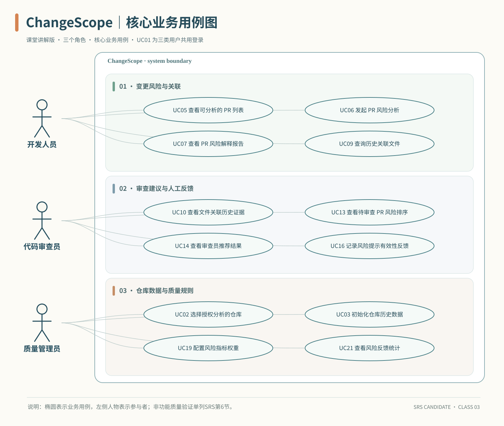

# ChangeScope · 项目需求规格与用例分析

**软件工程课程设计｜第3次课（第11周）｜需求讲解（二）**

**项目名称：** 基于 Git 历史挖掘的代码变更风险分析与审查决策支持系统  
**阶段：** 需求分析与规格说明  
**文档版本：** SRS v1.0 候选稿（待真人调研证据与组员评审确认）

> 本页集中展示本阶段的需求成果与模型，不包含演讲稿。系统功能、质量指标及用例目前是根据项目设计形成的候选需求；不能替代真实用户调研、评审和测试结果。

---

## 01. 项目背景与目标

GitHub Pull Request 可以展示直接修改的文件，但代码审查员还可能需要了解：*哪些未修改的文件与本次变更存在历史关联、哪些变化值得重点关注、有哪些候选审查员具备相关经验*。

**ChangeScope 的定位：** 面向多人 GitHub 协作场景，**重点缓解PR审查繁琐**：基于 Git 提交历史和 PR 元数据提供风险解释、关联文件提示、审查员推荐和人工反馈。**合并冲突也是交流中提到的困难，但当前不承诺自动解决；仅考虑可选的GitHub合并状态提示。**

**系统边界：** 辅助审查决策，不替代 GitHub 的代码评论、审批、冲突解决、合并或 CI 功能，也不将历史关联视为真实缺陷或合并冲突的证明。

## 02. 干系人与核心业务目标

| 主要干系人 | 典型目标 | 主要使用场景 |
|---|---|---|
| 开发人员 | 在评审前识别可能受影响的文件 | 发起 PR 风险分析；查看风险说明 |
| 代码审查员 | 核查变更的潜在关联与历史依据 | 查看关联文件；检查证据；提交反馈 |
| 质量管理员 | 管理风险规则并评价分析效果 | 同步仓库历史；配置权重；查看反馈 |

**典型业务链：** 授权仓库 → 采集 Git 历史 → 生成 PR 风险报告 → 查看关联文件与提交证据 → 人工核查与反馈 → 调整规则。

## 02A. 项目立项依据与初步调研

本组的项目选择并非凭空确定，前期选题讨论中，发起人明确提出了以下关注点：

> “不够新颖，太多人做了”  
> “继续推荐软件工程工具类选题，要求新颖、有技术深度、8周内可实现。”  
> “这些功能github本身有吗？有没有重复的地方”

据此，团队将方案限定为**有技术核心、8周内可分阶段交付、与GitHub原生审批功能不重复**的分析工具。

- [项目发起人原话与立项需求（真实选题依据）](docs/requirements/research/01_项目发起人真实需求陈述.md)
- [需求调研阶段报告（初稿：已知依据、待验证假设、后续访谈安排）](docs/requirements/research/02_需求调研阶段报告_初稿.md)
- [真人访谈提纲及原始记录模板](docs/requirements/research/03_真实用户访谈提纲与记录模板.md)

**新增交流发现：** 小组成员回忆此前曾和不少同学聊过多人PR协作，主要意见是“多人提交PR时有**合并冲突**，同时也有**PR审查繁琐**的问题”。这是项目组成员2026-11-26对以前交流的事后回忆澄清，**不是正式笔录或逐字引用**；人数、具体案例与两类问题的频率仍待向原同学核对。

- [查看非正式交流回忆纪要（OR-01/OR-02）](docs/requirements/research/04_非正式交流回忆纪要_待核对.md)
- [查看待发送的核对消息](docs/requirements/research/05_发给同学的核对消息.md)

**证据边界：** 上述原话来自项目发起人的选题讨论，不能替代开发人员、审查员的独立真实访谈。关于关联文件遗漏、风险评分和审查员推荐的价值，仍处于**待验证假设**阶段；目前不得宣称“已有若干受访者证实”。

**基于反馈的需求范围决定：** 核心仍是PR风险分析与影响范围核查；合并冲突提示列为`CR-CAND-01`候选扩展，不改变当前22个功能用例数量。详见[候选扩展需求与验证标准](docs/requirements/research/06_合并状态提示_候选扩展需求.md)。

## 03. 系统用例模型

共整理 **22 个候选功能用例**，覆盖上述三类角色。下图为核心用例预览。

[查看全部22个用例图](models/use-case-all.svg) · [查看完整 PlantUML 图源](models/use-case-all.puml)

## 04. 三个关键详细用例

| 编号 | 用例名称 | 主要参与者 | 可验收的目标 |
|---|---|---|---|
| UC06 | 发起 PR 风险分析 | 开发人员 | 结果与 PR head SHA、历史快照和规则版本绑定 |
| UC09 | 查询历史关联文件 | 代码审查员 | 展示关联强度、支持次数与历史提交证据 |
| UC19 | 配置风险指标权重 | 质量管理员 | 校验权重合法性，保留规则版本与审计信息 |

[查看三份详细用例规约、正常/异常流程与活动图](docs/requirements/detailed-use-cases.md)

**UC09 的关键验收示例（使用构造数据）：** 当文件 A 在历史中出现 25 次，其中有 18 次与 B 一同修改，且过滤阈值允许展示时，应显示文件 B、关联强度 0.72、支持次数 18 和可追溯的历史提交证据。

这只是用于验证计算规则的示例，不代表真实仓库观测或用户访谈结论。

## 05. 功能需求与非功能需求

[查看完整 SRS v1.0 候选稿](docs/requirements/SRS_v1.0_候选稿.md)

功能需求范围包含 GitHub 认证及授权、Git 历史采集与同步、文件共变更分析、PR 风险解释、审查员推荐、人工反馈与评分规则维护。

| 非功能需求 | 初步验收条件（待评审） |
|---|---|
| 性能 NFR-01 | 缓存历史、PR修改文件不超过50个时，至少95%的有效分析请求在5秒内完成 |
| 安全 NFR-02 | 未授权仓库访问和越权修改被拒绝，不暴露敏感凭证 |
| 可用性 NFR-03 | GitHub API 故障时，缓存报告仍可查看并准确显示更新时间和同步错误 |

## 06. 需求追溯

以文件关联分析为例：

`US09 用户故事` → `FR-09 功能需求` → `UC09 用例及活动图` → `TC-UC09-01 计划测试`

[查看完整需求追溯矩阵](docs/requirements/requirements-traceability.md) · [查看用户故事索引](docs/requirements/user-stories-index.md)

**追溯状态：** 模型编号与计划测试建立了初始对应关系。真实访谈证据链接和实际测试执行记录尚需补充。

## 07. 当前需求基线状态

| 检查项 | 当前资料状态 |
|---|---|
| 系统用例图 | 候选版完成，待组员核对 |
| 3个详细用例和活动图 | 候选版完成，待评审 |
| 非功能需求及验证场景 | 候选标准已编写，待确认与实测 |
| SRS v1.0 | 当前为候选稿，未提供批准证据 |
| 需求追溯矩阵 | 已编写初始映射，真实调研证据待补 |
| 用户故事 GitHub Issue | 已整理草稿，仍需在仓库逐条创建、分配并补证 |
| GitHub Release v1.0 | 需要评审通过后由小组实际发布 |

**下一阶段：** 核验真实干系人需求，完善和评审需求规约，形成批准版 SRS v1.0；通过 PR 合并并建立需求基线。后续所有需求调整通过 Issue、评审和变更记录追溯。
