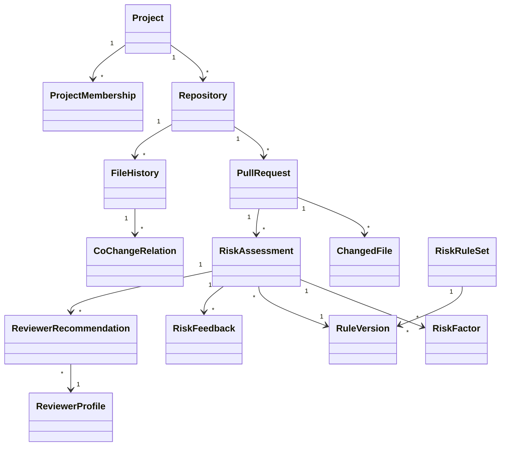

# ChangeScope：基于 Git 历史挖掘的代码变更风险分析与审查决策支持系统

> **文档性质：** 软件工程课程设计拟立项方案（重构版）  
> **项目英文名称：** Git History-Based Code Change Risk Analysis and Review Decision Support System  
> **项目代号：** ChangeScope  
> **参考依据：** 《软件工程课程设计要求（版本2）》《软件工程课程设计——课堂形式、内容与要求》  
> **说明：** 本文为设计方案，需求、性能指标、算法效果和技术选型尚需真实调研、评审及实验验证。

## 一、项目定位

### 1.1 核心构想

保留 Git 历史分析与 PR 风险评估，删除与 GitHub 重复的代码审查管理功能，把项目定位为具有独立分析能力的软件工程质量保障工具。

**一句话项目描述：**

系统通过分析 Git 仓库的历史提交记录和 Pull Request 变更信息，识别潜在高风险代码变更、发现历史关联文件，并根据开发人员的代码经验和审查负载提供审查员推荐，帮助团队合理分配代码审查资源。

### 1.2 与 GitHub 的职责划分

| GitHub 负责 | ChangeScope 负责 |
|---|---|
| 代码仓库管理 | Git 历史特征提取 |
| 创建、合并 PR | PR 风险排序 |
| 原生代码评论与审批 | 风险解释与证据展示 |
| 分支保护与 CI | 历史关联文件分析 |
| 仓库成员权限 | 审查员匹配与推荐 |
| 原生审查请求 | 审查建议与效果反馈 |

ChangeScope 不直接决定 PR 是否能够合并，也不替代 GitHub 的审批结果。

## 二、四个核心业务模块

### 模块 A：Git 历史关联分析

从 Git 提交记录中提取文件共同修改关系，构建文件关联图，识别 PR 可能需要额外检查的文件。

- **关键算法：** 文件共变更频次、关联强度、图遍历与关联排序。
- **主要产出：** 文件关联网络、关联文件列表、历史证据。

### 模块 B：PR 风险评估

根据修改规模、文件历史活跃度和共变更关系，计算可解释的风险分数。

- **关键算法：** 特征归一化、加权风险评分、风险因素贡献分析。
- **主要产出：** PR 风险等级、风险排序、指标解释报告。

### 模块 C：审查员推荐

根据候选人员对相关文件的历史修改经验、近期审查负载以及是否为 PR 作者等约束，给出推荐排序。

- **关键算法：** 文件经验匹配、工作负载评分、多因素排序。
- **主要产出：** 推荐审查员列表、匹配依据、负载信息。

### 模块 D：风险反馈与模型评价

审查员对风险提示的有效性进行反馈，管理员分析规则命中情况、误报情况和不同配置下的结果变化。

- **关键技术：** 反馈记录、统计评价、规则版本管理。
- **主要产出：** 风险反馈记录、模型评价报告、规则配置版本。

其中 A、B 是技术核心，C 是差异化应用，D 是验证分析结果价值的重要环节。

## 三、三种用户角色

| 角色 | 主要目标 | 独立业务价值 |
|---|---|---|
| 开发人员 | 在提交代码审查前发现潜在影响 | 减少遗漏关联文件的可能性 |
| 代码审查员 | 快速识别需要重点审查的变更 | 提高审查针对性 |
| 质量管理员 | 评估项目风险分布及规则效果 | 改进审查策略与风险模型 |

### 3.1 角色协作场景

假设某开发人员修改了认证模块中的 `AuthService.java`：

1. **开发人员：** 提交 PR，执行风险分析，发现历史上经常与认证模块共同修改的权限模块。
2. **ChangeScope 分析引擎：** 计算风险指标，识别关联文件，推荐具有相关模块经验的审查员。
3. **代码审查员：** 查看风险证据，检查权限模块是否受到影响，并反馈风险提示是否有效。
4. **质量管理员：** 查看项目风险趋势与反馈统计，调整风险规则，并比较调整前后的分析结果。

三个角色参与同一条风险分析业务链，但目标不同。

## 四、24个用例

课程要求不少于20个用例，其中至少2个为非功能需求用例。本方案规划22个功能用例和2个非功能需求验证场景。

### 4.1 功能用例

| 编号 | 用例名称 | 主要角色 |
|---|---|---|
| UC01 | GitHub 第三方登录 | 全部 |
| UC02 | 选择授权分析的仓库 | 质量管理员 |
| UC03 | 初始化仓库历史数据 | 质量管理员 |
| UC04 | 更新仓库分析数据 | 质量管理员 |
| UC05 | 查看可分析的 PR 列表 | 开发人员、审查员 |
| UC06 | 发起 PR 风险分析 | 开发人员 |
| UC07 | 查看 PR 风险解释报告 | 开发人员、审查员 |
| UC08 | 查看风险指标明细 | 开发人员、审查员 |
| UC09 | 查询历史关联文件 | 开发人员、审查员 |
| UC10 | 查看文件关联历史证据 | 开发人员、审查员 |
| UC11 | 比较 PR 不同版本的风险变化 | 开发人员 |
| UC12 | 查看个人 PR 风险记录 | 开发人员 |
| UC13 | 查看待审查 PR 风险排序 | 审查员 |
| UC14 | 查看审查员推荐结果 | 审查员、质量管理员 |
| UC15 | 查看审查员推荐依据 | 审查员、质量管理员 |
| UC16 | 记录风险提示有效性反馈 | 审查员 |
| UC17 | 记录关联文件核查结果 | 审查员 |
| UC18 | 查看项目风险趋势 | 质量管理员 |
| UC19 | 配置风险指标权重 | 质量管理员 |
| UC20 | 比较不同规则版本的评分结果 | 质量管理员 |
| UC21 | 查看风险反馈统计 | 质量管理员 |
| UC22 | 导出项目风险分析报告 | 质量管理员 |

这些用例应按照独立用户目标细化，不能仅将页面按钮机械拆分为用例。

### 4.2 非功能需求验证场景

| 编号 | 场景 | 建议验收指标 |
|---|---|---|
| NFR01 | 风险分析性能 | 对修改文件不超过50个、历史数据已缓存的测试 PR，95%的请求在5秒内完成 |
| NFR02 | 角色权限隔离 | 未授权角色无法修改风险规则或访问不属于其授权范围的仓库分析数据 |

上述指标为初始验收目标，最终应结合部署环境和测试结果确定需求基线。

## 五、18个分析类

删除原方案中与 GitHub 原生审查高度重叠的 `ReviewTask`、`ReviewComment`、`ReviewDecision` 等类，增加服务于风险分析的领域概念。

| 编号 | 分析类 | 主要职责 |
|---|---|---|
| C01 | User | 用户信息 |
| C02 | Project | 分析项目 |
| C03 | ProjectMembership | 用户与项目的成员关系及角色 |
| C04 | Repository | Git 仓库 |
| C05 | PullRequest | PR 信息 |
| C06 | Commit | Git 提交 |
| C07 | ChangedFile | 文件变更 |
| C08 | FileHistory | 文件历史修改信息 |
| C09 | CoChangeRelation | 文件共变更关联 |
| C10 | AnalysisJob | 分析任务 |
| C11 | RiskAssessment | 风险评估结果 |
| C12 | RiskFactor | 风险因素及贡献 |
| C13 | RiskRuleSet | 风险规则配置 |
| C14 | RuleVersion | 规则版本 |
| C15 | ReviewerProfile | 审查员历史经验信息 |
| C16 | ReviewerRecommendation | 审查员推荐结果 |
| C17 | RiskFeedback | 风险提示反馈 |
| C18 | EvaluationReport | 风险模型评价报告 |

### 5.1 核心分析类关系示意

此图为初步概念关系图，正式需求分析阶段还需验证类职责、属性、多重性，以及共变更关系是否需要独立建模。

## 六、核心算法设计

采用三个可解释、可实现、可验证的算法，不以引入复杂大模型作为创新前提。

### 6.1 算法一：文件共变更关系分析

将每次 Git 提交视为一个文件集合。如果两个文件经常在同一次提交中出现，就记录它们的共变更关系。

$$
\operatorname{CoChange}(A,B)=\frac{N(A,B)}{N(A)}
$$

其中：

- $N(A,B)$：文件 A、B 在同一次提交中被修改的次数。
- $N(A)$：文件 A 被修改的提交次数。

该指标衡量在 A 被修改的历史提交中，B 同时被修改的比例，具有方向性。

**示例（假设数据）：**

| 文件对 | 共同修改次数 | A修改次数 | 关联比例 |
|---|---:|---:|---:|
| AuthService → PermissionService | 18 | 25 | 0.72 |
| AuthService → UserController | 12 | 25 | 0.48 |
| AuthService → LogService | 3 | 25 | 0.12 |

当 PR 修改 `AuthService` 时，系统可以优先提示检查 `PermissionService`。

**局限：** 历史共变更不等于静态代码依赖，也不意味着两个文件必须同时修改。实际分析还应设置最小共同提交次数，过滤大规模格式化提交、自动生成文件等噪声。

### 6.2 算法二：PR 风险评估

采用可解释的加权评分模型：

$$
R=100(w_sS+w_hH+w_cC)
$$

其中：

- $S$：变更规模风险。
- $H$：文件历史修改活跃度。
- $C$：关联文件风险。
- $w_s+w_h+w_c=1$。

所有指标先归一化至0—1范围，权重由管理员配置。

**交互示例的静态计算：** 假设 $S=0.65$、$H=0.40$、$C=0.85$，权重分别为 $0.40$、$0.25$、$0.35$，则

$$
R=100(0.40\times0.65+0.25\times0.40+0.35\times0.85)=65.75
$$

此处为假设数据，不代表真实仓库的风险结论。在正式系统中，风险等级阈值需要通过样本分析确定。

### 6.3 算法三：审查员推荐

构建审查员匹配分数：

$$
M(u,p)=\alpha E(u,p)+\beta A(u)-\gamma L(u)
$$

其中：

- $E(u,p)$：候选审查员对 PR 涉及文件的历史经验。
- $A(u)$：候选审查员近期活跃程度。
- $L(u)$：当前审查负载。

实际实现中需要统一指标尺度，过滤 PR 作者本人、无权限人员等不合格候选者。

第一版只推荐，不自动在 GitHub 上分配审查任务。

## 七、三个可交付增量

| 增量 | 核心内容 | 可独立验收的成果 |
|---|---|---|
| v0.1 数据分析基础 | GitHub 登录、仓库授权、Git 历史采集、共变更关系分析 | 能够分析指定仓库并显示文件关联关系 |
| v0.2 风险评估 | PR 特征提取、风险评分、风险解释、历史分析记录 | 能够生成 PR 风险报告并通过算法测试 |
| v0.3 决策支持 | 审查员推荐、风险反馈、规则版本、评价报告 | 三种角色完成风险分析、审查反馈和质量管理流程 |

三个增量均应具有可运行、可测试、可演示的成果。实际开发中按照课程要求组织至少两轮完整的计划、构造、测试、评审迭代，并保留 GitHub 证据。

## 八、技术架构与选型

| 层次 | 建议技术 | 作用 |
|---|---|---|
| 前端 | Vue 3 + TypeScript | 交互页面 |
| 可视化 | ECharts | 风险趋势、文件关系图 |
| 后端 | FastAPI | API 与业务服务 |
| 数据采集 | GitPython + GitHub REST API | Git 历史与 PR 数据 |
| 算法 | Python + NetworkX | 关联图与推荐计算 |
| 数据库 | PostgreSQL | 持久化数据 |
| 身份认证 | GitHub OAuth | 第三方登录 |
| 自动测试 | Pytest | 单元及集成测试 |
| 部署 | Docker Compose | 统一部署 |
| CI | GitHub Actions | 自动构建和测试 |

### 8.1 技术风险

| 风险 | 严重程度 | 处理策略 |
|---|---|---|
| 大型仓库历史分析耗时过长 | 高 | 限制历史范围、缓存、增量更新 |
| 共变更关系产生大量噪声 | 高 | 设置频次阈值、过滤异常提交 |
| 审查员历史数据不足 | 中 | 提供规则降级和无推荐提示 |
| 风险评分有效性不足 | 高 | 与简单基线对比、人工核查样本 |
| GitHub API 限流 | 中 | 缓存、重试、限流处理 |

建议将“共变更关系噪声”和“风险评分有效性”列为主要技术风险。

## 九、技术价值的验证方案

项目不能只展示风险评分界面，还应设计至少三类实验。

| 实验 | 评价问题 | 可采用的指标 |
|---|---|---|
| 文件关联分析 | 关联文件推荐是否有参考价值？ | Precision@K、人工核查结果 |
| PR 风险排序 | 是否优于仅按变更行数排序？ | Precision@K、排序效果 |
| 审查员推荐 | 是否能推荐具有相关经验的人员？ | Hit@K、负载分布、人工评价 |

对于历史缺陷关联实验，需要谨慎处理缺陷修复提交与 PR 的对应关系，避免将未经验证的标签作为真实缺陷数据。

项目的技术贡献不在于发明全新的算法，而在于**设计一套有明确业务用途、可解释且经过实验验证的代码审查辅助方法**。

## 十、与课程要求的符合性

| 课程硬性要求 | ChangeScope 2.0 方案 |
|---|---|
| 真实业务背景 | 软件开发团队 PR 审查 |
| 至少3种用户角色 | 开发人员、审查员、质量管理员 |
| 权限控制 | 项目级角色权限控制 |
| 至少20个用例 | 22个功能用例＋2个非功能验证场景 |
| 至少15个分析类 | 18个分析类 |
| 至少3个可交付增量 | v0.1、v0.2、v0.3 |
| 至少1个外部集成点 | GitHub OAuth |
| 至少1个技术风险 | 已规划5项风险 |
| 至少2轮完整迭代 | 在开发阶段组织并留痕 |
| 需求、分析、设计模型 | 按课程检查点逐步形成 |
| 测试与部署 | Pytest、GitHub Actions、Docker |
| AI 使用报告 | 按课程规范记录与人工审核 |

上述是规划层面的对应关系，后续仍需通过实际开发、测试和评审证明满足要求。

## 十一、最终建议范围

### 11.1 必须完成

GitHub 集成、Git 历史采集、共变更分析、PR 风险评分、风险解释、三个角色权限、基本反馈、自动化测试。

### 11.2 重点争取完成

审查员推荐、规则版本比较、风险趋势可视化、算法评价报告。

### 11.3 暂不纳入第一版

自动代码修复、大模型语义审查、自动审批、复杂跨语言依赖分析、完整 CI 质量平台。

### 11.4 最终结论

ChangeScope 2.0 比原方案更适合正式立项。原方案侧重“GitHub 代码审查管理＋风险评分”，与 GitHub 重复较多；新方案则形成清晰的技术主线：

**Git 历史数据 → 文件关联挖掘 → PR 风险评估 → 审查员推荐 → 人工反馈与算法评价。**

该主线具有真实业务场景，也能够支撑课程要求的需求建模、类建模、设计、迭代、测试和部署。

**立项前建议开展小型可行性实验：** 选择一个具有一定提交历史的开源仓库，实现文件共变更统计，并检查关联结果是否有意义，以验证项目最重要的技术基础。
