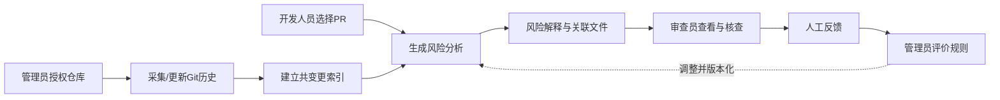
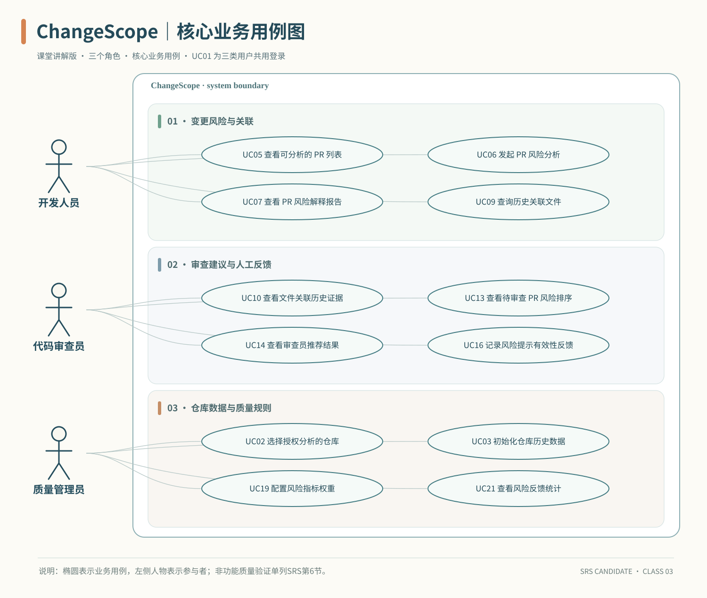

# ChangeScope 软件需求规格说明书（SRS v1.0 候选稿）

> **文档状态：DRAFT / 待真实调研补证 / 待组员评审。** 
> 本稿是课堂展示与评审的工作版本，**尚不是已批准的 SRS v1.0 需求基线**。
> 项目仓库：https://github.com/weisi9188-dot/Software_Engineering_Project
> 上游设计：`ChangeScope_Design.md`（以仓库现有方案为基础）
> 课程节点：第3次课（第11周），学生讲解项目需求（二）
> 编制日期：2026-11-26
> 评审人、评审日期、结论：**均待真实填写**。AI 协助整理，由小组核对并承担最终责任。

## 0. 文档控制

| 版本标识 | 日期 | 修改内容 | 状态 |
|---|---|---|---|
| 0.9-candidate | 2026-11-26 | 首次整理完整需求、用例与验收指标 | 待调研与评审 |
| 1.0 | 待填写 | 经真实访谈核实、正式评审通过后发布 | 未发布 |

**需求基线建立条件：** 真人干系人反馈已记录并建立证据链接；四人小组评审完成并记录评审意见、修改及确认；SRS 通过 PR 合并；发布 GitHub Release `v1.0`。这些步骤不能由文档代替。

## 1. 引言

### 1.1 目的
说明 ChangeScope 的业务目标、用户角色、系统边界、功能与非功能需求、验收方法和追溯规则，为后续分析模型、设计、编码和测试提供一致依据。

### 1.2 产品定位
ChangeScope 是面向中小型 GitHub 协作开发团队的**PR审查风险与变更影响分析系统**。前期同学交流的事后回忆明确涉及**合并冲突**和**PR审查繁琐**两类困难：本项目优先支持后者，可将合并状态提示作为待确认扩展，但**不自动解决Git合并冲突**。通过 Git 历史提交记录和 Pull Request（PR）变更信息，识别历史共变更文件，给出可解释的 PR 风险提示、审查员推荐及人工反馈分析。

**不替代 GitHub：** PR 创建与合并、代码评论与审批、分支保护、CI 执行仍在 GitHub 完成。ChangeScope 不自动合并 PR、不自动代替人工评审，也不能凭评分证明代码存在缺陷。

### 1.3 术语
| 术语 | 含义 |
|---|---|
| PR | Pull Request，代码合并请求 |
| SHA | 标识一次 Git 提交的哈希值 |
| 共变更关系 | 两个文件在同一次历史提交中共同被修改的统计关系 |
| 风险评分 | 由规则计算的审查关注度提示，不等于缺陷发生概率 |
| 分析快照 | 风险计算所用 PR head SHA、历史数据窗口及规则版本的固定组合 |
| 用户故事 | “作为……我想……以便……”形式的干系人需求 |
| SRS | Software Requirements Specification，软件需求规格说明书 |

### 1.4 编写依据
- 《软件工程课程设计——课堂形式、内容与要求》：第3次课要求讲解用例图、场景、非功能需求，并完成需求↔用例追溯矩阵。
- 《软件工程课程设计要求（版本2）》：至少3类用户角色、20个用例、15个分析类、3个增量、外部集成等总体约束。
- 第2课教师对话：至少20条用户故事 Issue、至少3条非功能用户故事、Given/When/Then 验收标准。
- 仓库 `ChangeScope_Design.md`：三种角色、22个功能用例、技术路线与边界。

**证据边界：** 当前仅能依据设计方案提出需求假设；真实用户访谈纪要、问卷数据和评审签字必须由小组补充，不能把拟议需求写成已验证事实。

## 2. 系统背景与业务目标

**选题依据与调研状态：** 项目发起人在真实选题讨论中表达过“希望选题新颖”“软件工程工具类、有技术深度、8周内可实现”“至少3个角色”“避免重复GitHub已有功能”等要求。原话和逐条解析参见 [项目发起人需求陈述](research/01_项目发起人真实需求陈述.md)；当前初步调研整理见 [阶段调研报告](research/02_需求调研阶段报告_初稿.md)。这些是**选题动机证据**，不是对外部开发人员的用户访谈结论。下述PR审查痛点仍待真人验证。

**补充的先前同学交流线索：** 小组成员事后回忆，曾有多位同学提及多人协作开发时 PR 合并、检查过程繁琐；目前没有当场记录、精确人数或受访者确认。详见 [非正式口头交流回忆纪要](research/04_非正式交流回忆纪要_待核对.md)。这只支持“多人PR协作审查存在困难”的初步问题线索，**不能证明**文件遗漏、合并冲突或评分有效性等具体判断。

### 2.1 两类协作痛点与问题定义（新补充）

项目组成员根据此前与同学的非正式交流，明确补充**两种困难都曾被反映**：

- **P-01 合并冲突：** 并行修改后的 Git 分支合并可能出现文本/内容冲突，需要人工定位并解决。
- **P-02 PR审查繁琐：** 多人并行提交时，多个PR的变更检查、理解影响范围和安排审查比较繁琐。

**资料性质：** P-01/P-02 是项目组成员对既往同学交流的**事后回忆及分类澄清**，未保存当场笔录、具体受访者数量、原话及例子；见 [回忆纪要](research/04_非正式交流回忆纪要_待核对.md)。不可写成经正式访谈验证的结论。

**范围选择：** P-02 是本项目重点解决的问题；P-01 仅保留“可选的GitHub合并状态提示”作为候选增量（详见 `CR-CAND-01`），不做自动冲突修复、冲突代码修改或替代GitHub合并操作。与“历史共变更”不同，Git合并冲突不能用历史关联强度代替检测。

### 2.2 需要验证的业务问题
1. 审查员在仅查看 PR 直接修改文件时，可能遗漏历史上经常共同变化的相关文件。
2. 团队难以统一说明“为什么这一 PR 值得优先审查”，单看改动行数未必足够。
3. 审查员选择过程可能缺少透明、可核查的历史经验依据。
4. 风险工具如果没有人工反馈机制，难以持续检查误报与策略效果。

以上是**调研假设**，并非真实访谈结论。访谈结束后记录其成立、部分成立或被否定的证据。

### 2.3 项目目标（拟议）
- O1：为每次可分析 PR 提供与明确输入快照关联、可复核的风险结果。
- O2：提供文件共变更比例、支持次数及历史提交证据，辅助审查范围判断。
- O3：给出经权限和“不能推荐 PR 作者本人”规则过滤的审查员候选建议。
- O4：支持审查员反馈，并使质量管理员能够查看规则版本与评价样本。
- O5：每一条需求均能追溯到用例、验收标准和后续测试，并最终指向真实调研证据。

这些是设计目标，不应宣传为已实现的效果或经实测达到的水平。

### 2.4 系统边界与外部依赖
**系统内：** OAuth 登录集成、项目授权范围、Git 历史采集与增量同步、文件共变更索引、PR 风险评分、风险解释、审查员推荐、人工反馈、规则版本及报告导出。

**可选扩展（未纳入22个已编功能用例）：** `CR-CAND-01` 在有权限、GitHub已给出可靠可合并状态时显示“可合并/冲突/未知”；未知不能显示成“无冲突”，点击前往GitHub原生页面处理。尚未经过用户确认与可行性评审，不保证实施。

**系统外：** GitHub 负责仓库托管、PR 生命周期、实际审查评论与批准、代码合并；外部 GitHub API 可能限流或临时不可用。

### 2.5 三个可交付增量（拟议，不代表已经开发）

| 增量 | 核心范围 | 必须能够独立演示的结果 |
|---|---|---|
| v0.1 数据分析基础 | GitHub登录、仓库授权、历史采集、共变更索引 | 能看到一个授权仓库的历史关联文件及支持次数 |
| v0.2 风险评估 | PR变更特征、风险评分、解释与历史记录 | 对固定PR输入生成有版本和来源的风险分析报告 |
| v0.3 审查决策支持 | 审查员推荐、反馈、规则版本、统计报告 | 三类角色完成建议→核查→反馈→改进规则的辅助流程 |

增量发布不是两轮正式迭代的替代品：后续至少安排两轮“计划—构造—测试—评审”及回顾记录。

### 2.6 核心业务流程

## 3. 干系人与权限边界

| 干系人 | 主要目的 | 授权操作 | 禁止或限制 |
|---|---|---|---|
| 开发人员 | 在提交审查前识别关联影响 | 浏览可访问PR、发起分析、查看个人分析与关联依据 | 不得修改全局风险规则、读取未授权仓库 |
| 代码审查员 | 定位重点风险并反馈实际核查 | 查看风险排序、证据、审查员建议、提交反馈 | 反馈不等于 GitHub 审批，不能越权修改规则 |
| 质量管理员 | 维护分析规则并评价效果 | 仓库授权、历史索引维护、规则版本、统计与导出 | 不能将无权限仓库加入分析 |
| GitHub/仓库维护方（外部） | 授权、提供真实提交/PR元数据 | 提供 OAuth、API、仓库访问设置 | 不视为本系统内第四种业务角色 |

### 3.1 核心权限矩阵（拟议）

| 业务操作 | 开发人员 | 代码审查员 | 质量管理员 |
|---|:---:|:---:|:---:|
| 登录并访问获授权项目 | ✓ | ✓ | ✓ |
| 查看PR及其风险解释 | ✓ | ✓ | 在授权范围内可查看 |
| 发起PR风险分析（UC06） | ✓ | — | — |
| 查询关联文件及证据 | ✓ | ✓ | — |
| 查看审查员推荐 | — | ✓ | ✓ |
| 提交风险有效性反馈 | — | ✓ | — |
| 仓库历史初始化/更新 | — | — | ✓ |
| 调整规则、查看统计与导出 | — | — | ✓ |

如团队决定某角色还需额外授权，应以真实调研依据更新矩阵并保留变更记录。

**权限决策在后端执行。** 显示或隐藏页面元素不能代替服务端鉴权。同一用户可能承担不同角色，以**具体项目授权**为准。

## 4. 主要使用场景

**场景 A：开发者提交前检查。** 开发者选择其授权仓库的一个 PR → 发起分析 → 系统固定 `head SHA` / 历史数据窗口 / 规则版本 → 查看整体分数和关联文件 → 必要时打开历史提交证据。若 PR 已更新，旧报告必须标注“历史版本/已过期”。

**场景 B：审查员核查与反馈。** 审查员按风险排序查看待审查 PR → 查看文件关联依据 → 核查影响范围 → 记录“有效/无效/待确认”等反馈。真正批准或要求修改，仍回到 GitHub 原生 PR 页面操作。

**场景 C：管理员评价风险规则。** 管理员查看趋势与反馈统计 → 配置三类评分因素的权重 → 规则生成新版本 → 使用相同历史输入比较两个版本的评分，避免把数据变化误认为规则效果。

## 5. 功能性需求

**统一编号规则：** 用户故事为 `US01`—`US25`（`US01`—`US22`为功能，`US23`—`US25`为非功能）；`FR-XX`代表功能需求，`NFR-XX`代表非功能需求，`UCXX`代表功能用例。非功能需求编号**不是**故事编号。旧版本对应关系见 [故事编号迁移对照](story-id-migration.md)。正式需求变更须保留编号稳定性。完整Given/When/Then见 `docs/requirements/issue-drafts/`。

| 需求ID | 用例ID | 功能名称 | 主要参与者 | 系统必须支持的能力 | 优先级 |
|---|---|---|---|---|---|
| FR-01 | UC01 | GitHub 第三方登录 | 全部角色 | 通过 GitHub 身份认证进入系统，并获取本人获准访问的项目范围 | P0 |
| FR-02 | UC02 | 选择授权分析的仓库 | 质量管理员 | 选择一个当前账户有访问权限的 GitHub 仓库作为分析对象 | P0 |
| FR-03 | UC03 | 初始化仓库历史数据 | 质量管理员 | 采集指定仓库的历史提交与变更文件元数据，建立分析索引 | P0 |
| FR-04 | UC04 | 更新仓库分析数据 | 质量管理员 | 同步新提交并更新文件共变更索引 | P0 |
| FR-05 | UC05 | 查看可分析的 PR 列表 | 开发人员、代码审查员 | 按授权仓库浏览 PR 基本信息与当前版本 | P0 |
| FR-06 | UC06 | 发起 PR 风险分析 | 开发人员 | 选择 PR 生成与其最新提交绑定的风险评估结果 | P0 |
| FR-07 | UC07 | 查看 PR 风险解释报告 | 开发人员、代码审查员 | 查看整体风险分数、等级和主要影响因素 | P0 |
| FR-08 | UC08 | 查看风险指标明细 | 开发人员、代码审查员 | 追查风险评分各因素的原始值、归一化值和贡献 | P1 |
| FR-09 | UC09 | 查询历史关联文件 | 开发人员、代码审查员 | 找出与 PR 修改文件有历史共变更关系的其他文件 | P0 |
| FR-10 | UC10 | 查看文件关联历史证据 | 开发人员、代码审查员 | 查看某条关联推荐所依据的历史提交 | P0 |
| FR-11 | UC11 | 比较 PR 不同版本的风险变化 | 开发人员 | 比较同一 PR 不同 head SHA 的风险分析结果 | P1 |
| FR-12 | UC12 | 查看个人 PR 风险记录 | 开发人员 | 查看自己可访问 PR 的历史风险分析记录 | P1 |
| FR-13 | UC13 | 查看待审查 PR 风险排序 | 代码审查员 | 将可访问且待审查的 PR 按风险提示值排序 | P1 |
| FR-14 | UC14 | 查看审查员推荐结果 | 代码审查员、质量管理员 | 对指定 PR 获取符合约束条件的候选审查员排序 | P1 |
| FR-15 | UC15 | 查看审查员推荐依据 | 代码审查员、质量管理员 | 检查某候选人的代码经验和工作负载依据 | P1 |
| FR-16 | UC16 | 记录风险提示有效性反馈 | 代码审查员 | 对风险提示标记有效、无效或待确认并给出说明 | P0 |
| FR-17 | UC17 | 记录关联文件核查结果 | 代码审查员 | 登记推荐关联文件已检查及发现情况 | P1 |
| FR-18 | UC18 | 查看项目风险趋势 | 质量管理员 | 查看授权项目不同时间段的风险分布 | P1 |
| FR-19 | UC19 | 配置风险指标权重 | 质量管理员 | 调整风险规模、历史活跃度和文件关联指标的权重 | P0 |
| FR-20 | UC20 | 比较不同规则版本的评分结果 | 质量管理员 | 在相同 PR 输入和历史快照下比较规则配置效果 | P1 |
| FR-21 | UC21 | 查看风险反馈统计 | 质量管理员 | 汇总审查员的反馈类别和样本数量 | P1 |
| FR-22 | UC22 | 导出项目风险分析报告 | 质量管理员 | 导出授权范围内的风险分析汇总报告 | P2 |

### 5.1 关键功能规则
- **FR-03/04（历史数据）：** 保存分析窗口、处理范围和增量同步水位；重复同步不能重复计入同一提交。合并提交、重命名、超大提交、生成文件的处理策略列为待确认配置。
- **FR-06（分析快照）：** 结果与 PR `head SHA`、数据快照、规则版本绑定；发生新提交后不得将旧结果不加提示地展示为当前版本。
- **FR-07/08（解释性）：** 总览回答“是否值得关注”，明细回答“每个因素怎么算的”；评审时验证两个操作有独立用户目标。
- **FR-09/10（共变更）：** 关联强度初稿为 `N(A,B)/N(A)`，其中 `N(A,B)` 为共同修改次数、`N(A)` 为 A 修改的提交数。它是**有方向性的历史统计关系**，不是语义依赖或缺陷证明。
- **FR-14/15（推荐）：** 排除 PR 作者和无权限候选人，依据历史文件经验与审查负载排序；若历史不足，应显示“暂无可靠推荐”而不是虚构分数。
- **FR-19（规则）：** 权重合法且和为1；每次变更生成新规则版本，保留变更人、时间和旧值。
- **FR-20（规则对比）：** 比较两个规则时固定 PR 版本和历史快照，防止混杂因素。
- **FR-16/17（反馈）：** 人工反馈属于 ChangeScope 数据，不得反向冒充或改变 GitHub 的正式审查结论。

### 5.2 算法性需求与局限（拟议）
1. 文件共变更指标：`CoChange(A,B) = N(A,B) / N(A)`，分母为0时不产生关系；设置最小共变更次数与过滤阈值（待评审）。
2. 风险评分：`R = 100 × (w_s×S + w_h×H + w_c×C)`；`S/H/C` 归一化到 `[0,1]` 且权重非负、总和为1。风险等级阈值待真实实验确定，不使用随机阈值宣称“高风险”等于真实缺陷。
3. 审查员推荐：候选匹配综合历史文件经验、近期活跃度和审查负载，排除无资格人员；不自动指定 GitHub 审查员。
4. 时间因果约束：历史 PR 样本做离线评价时，**只能使用 PR 对应时间点以前可用的数据**，避免把未来提交引入过去的风险预测。

## 6. 非功能需求与验证场景

课程第2次课要求**至少3条非功能故事（性能、安全、可用性）**。原设计已有2项，因此本候选 SRS 扩展为3项；这些是待团队确认的验收目标。

| ID | 质量属性 | 验证场景 | 候选验收标准 | 计划测试编号 |
|---|---|---|---|---|
| NFR-01 | 性能 | 风险分析性能 | 至少95%的有效请求在5秒内返回分析结果；记录硬件、数据量、测试脚本与原始时延 | VT-NFR01 |
| NFR-02 | 安全 | 权限与数据安全 | 全部请求被拒绝（401或403），数据库无越权写入，响应与日志均不暴露 GitHub 凭证 | VT-NFR02 |
| NFR-03 | 可用性 | 外部服务故障下的可用性 | 缓存报告可查看且标注更新时间；同步任务在10秒内显示可重试的失败状态，服务恢复后可手动重试成功 | VT-NFR03 |

**NFR-01 测试边界：** 指标仅用于“历史索引已缓存、PR 修改文件≤50”的受控环境，不应把首次克隆/采集 Git 历史的耗时算进同一性能指标。正式测试须报告 CPU、内存、仓库规模、并发条件、样本量与原始数据。

**NFR-02 数据治理：** 不将 GitHub 访问凭证写入仓库、日志或演示截图；只申请与功能相符的最小权限，撤销授权后不得继续访问私有仓库数据。原仓库公开或私有的授权边界必须明确。

**NFR-03 故障恢复：** 使用可重复的模拟 API 错误测试；“缓存可查看”不等于后台数据已经成功更新，界面需展示最后同步时间和错误状态。

## 7. 用例模型

核心用例图预览：

- 完整22项用例的正式 PlantUML 图源：`models/use-case-all.puml`
- 核心用例 PlantUML 图源：`models/use-case-main.puml`
- 三个关键业务的细化用例：`docs/requirements/detailed-use-cases.md`
- 三个业务活动图：`models/activity/UC06.mmd`、`UC09.mmd`、`UC19.mmd`

> 注意：UML 图中呈现业务目标型用例；非功能质量指标单独通过验证场景和测试用例体现，不硬塞成业务椭圆。

## 8. 数据需求与完整性约束

| 数据对象 | 核心字段（拟议） | 完整性与安全要求 |
|---|---|---|
| Repository | `owner/name`, GitHub id, 授权范围 | 只收集授权仓库；不得泄漏私有数据 |
| PullRequest | PR 编号、作者、head SHA、状态、更新时间 | 不同版本不可覆盖历史结果 |
| Commit / ChangedFile | SHA、时间、路径、变更类型 | 重命名/合并提交过滤规则留痕 |
| CoChangeRelation | 文件A/B、计数、关联比例、历史窗口 | 分母非零；保留形成依据 |
| RiskAssessment | PR SHA、历史快照、规则版本、分数、时间 | 输入与输出可追溯；旧数据提示过期 |
| RuleVersion | 权重、创建人、时间、说明 | 版本不可静默覆盖 |
| ReviewerRecommendation | 候选人、依据、排序、分析版本 | 禁止推荐 PR 作者/无权限者 |
| RiskFeedback | 提示标识、结论、审查员、时间 | 防重、审计、匿名化展示统计 |

**个人数据最小化：** 优先保留必要的 GitHub 公开元数据与聚合统计；不采集邮件正文、不保存源代码全文作为默认持久化内容。

## 9. 外部接口、异常与依赖

- **OAuth：** 登录成功建立会话；取消授权、无权限或授权过期需给出清晰状态，不创建虚假成功会话。
- **GitHub API：** 获取仓库、PR、提交与文件信息，遵守授权范围；对限流、网络异常和分页结果进行明确处理，不默默返回“0个 PR”掩盖失败。
- **数据新鲜度：** 存在缓存时展示更新时间；最新提交变化后提示风险报告过期。
- **异常处理：** 同步中断保留已完成进度和错误摘要；重试须保持幂等；无审查员数据时显示无可用推荐。

## 10. 验收、测试与可追溯要求

- 每项 `FR-XX` 应对应 `UCXX`、用户故事 `USXX`、至少一个测试编号 `TC-UCXX`，且在 `requirements-traceability.md` 中维护。
- 每项 `NFR-XX` 对应独立质量验证 `VT-NFRXX`，测试保留环境、输入、预期和实测结果。
- 真实调研证据链接初始为 **`待补充`**；访谈结束后填入具体仓库相对路径或 Issue 链接。
- 若确认某功能并非真实需求，允许取消或调整，但必须记录变更原因、影响范围与评审结论。

## 11. 技术与需求风险

| 编号 | 风险 | 缓解策略 | 验证方式 |
|---|---|---|---|
| R-00 | 将合并冲突误当成历史关联风险，造成错误功能承诺 | 明确范围区分；冲突提示作为可选需求，保留未知状态 | 对比GitHub真实可合并状态与数据不足情况 |
| R-01 | GitHub API 限流或失效 | 缓存、分页、重试、失败提示 | 模拟429/5xx和断网 |
| R-02 | 文件共变更出现噪声 | 最小支持次数、异常提交过滤、抽样人工核查 | 用虚构与公开样本对照 |
| R-03 | 风险评分缺乏预测能力 | 解释性指标+基线比较，不作缺陷断言 | 与按变更行数排序的基线比较 |
| R-04 | 历史数据过少无法推荐审查员 | 数据稀缺告警、回退到人工选择 | 空历史/低样本测试 |
| R-05 | 访问凭证/项目数据越权 | 后端项目级鉴权、最小权限、审计 | 越权攻击用例和日志检查 |

## 12. 需求基线与变更控制

候选需求经人工评审通过后建立 `v1.0` 基线，步骤如下：
1. 真实用户调研与证据整理 → 每个故事建立依据；
2. 需求评审 → 记录参与人、问题、修改与结论；
3. PR 提交至仓库 → 至少1位同伴 Review，通过检查后合并；
4. 在仓库创建 `Release v1.0`，内容指向 SRS、用例图、需求追溯矩阵；
5. 后续变更以 Issue 提出，分析受影响的 FR、UC、设计及测试，评审后合并并更新版本。

当前执行状态：**第1—4步未在本材料包中得到已完成证据**。不可仅凭生成的模板声称已评审、已合并或已发布。

## 13. 当前待确认问题

1. 真实受访者是否将“遗漏历史关联文件”视为主要痛点？
2. 三种业务角色是否符合真实开发团队的工作分工？
3. 支持的仓库权限范围是公开仓库优先还是也允许私有仓库？
4. 大规模提交、merge commit、文件重命名如何过滤和解释？
5. 共变更关联阈值、最小共同提交次数如何确定？
6. 风险等级阈值和性能样本仓库如何确定？
7. 审查负载指标是否能通过合法且充分的数据获得？
8. UC07/08、UC14/15 能否在访谈中证明有独立用户价值？

这些问题须记录在评审中，未定项不应写作已确认结论。
