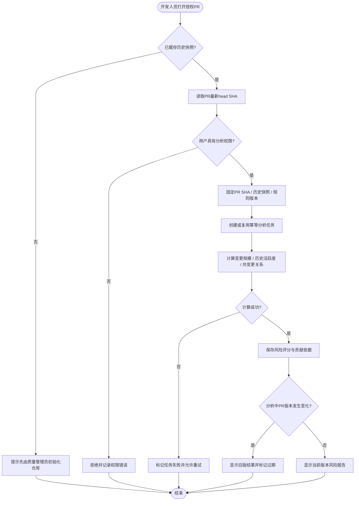
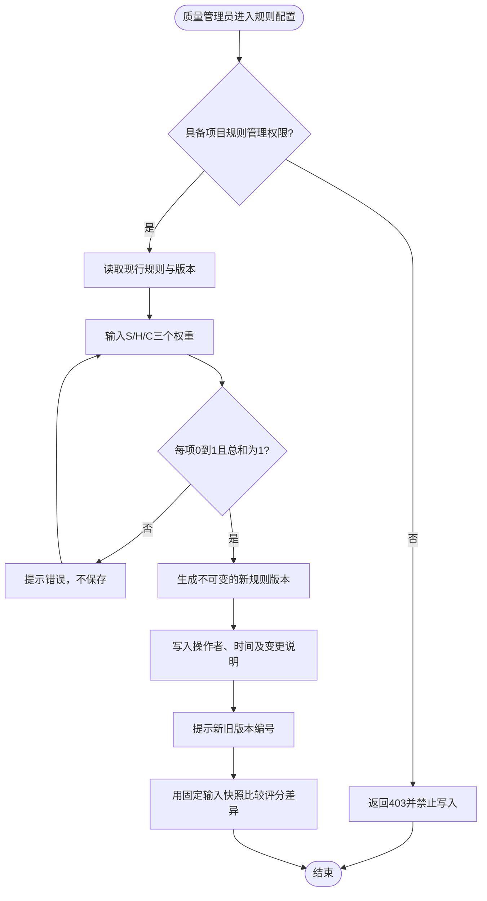

# ChangeScope 三个详细用例及活动图

> 状态：**细化草案，待访谈和人工评审确认**。用例基于原仓库设计中的编号，不主张这些流程已实现。
> 角色覆盖：开发人员（UC06）、代码审查员（UC09）、质量管理员（UC19）。
> 每个用例提供前置条件、触发事件、主成功场景、异常分支、后置条件、验收标准与活动图。

## UC06 发起 PR 风险分析

| 属性 | 说明 |
|---|---|
| 用例ID / 关联需求 | UC06 / FR-06 / US06 |
| 主要参与者 | 开发人员 |
| 目标 | 为一个明确版本的 PR 生成可解释风险报告，协助提交前检查 |
| 触发器 | 开发人员选择 PR 后点击“分析” |
| 前置条件 | 用户已登录并获仓库授权；PR 已同步；历史索引可用；风险规则至少有一个有效版本 |
| 成功后置条件 | 形成 `PR head SHA + 历史窗口快照 + 规则版本 + 分析时间 + 风险结果` 的记录 |
| 最小保证 | 不论成功失败均保留任务状态；失败不生成“成功分析”假记录 |

**主成功场景**

1. 开发人员进入授权仓库的 PR 列表，选择 PR。
2. 系统读取该 PR 最新 `head SHA` 和可用历史快照。
3. 系统检验该用户对项目的分析权限。
4. 系统固定 PR head SHA、历史窗口和当前风险规则版本。
5. 系统创建分析任务，提取修改文件数、历史活跃度、共变更特征。
6. 系统将归一化指标按权重计算为风险分数，同时记录贡献解释。
7. 系统保存结果，并给用户显示风险报告及生成时间。

**替代 / 异常流程**

- A1：未授权 → 阻止分析并返回明确错误。
- A2：历史尚未初始化 → 显示“先初始化仓库历史”的提示，不能把缺失数据当成低风险。
- A3：GitHub API 限流 / 采集失败 → 保存失败状态与可重试理由，不伪造成功分数。
- A4：分析过程中 PR `head SHA` 已改变 → 旧版分析仍可查看，但要标记“过期，需要对新版本重新分析”。
- A5：对同一固定输入重复点击 → 可复用/幂等处理，避免重复占用分析任务。

**验收标准（候选）**

- Given：用户对 PR 有分析权限，历史缓存与有效规则存在；
- When：对 PR 的 `head SHA = H1` 发起分析；
- Then：存在唯一可识别的分析记录，包含 H1、历史快照、规则版本、评分和解释；若 PR 更新为 H2，原报告显示“基于 H1 / 已过期”。

**关联测试草案：** `TC-UC06-01` 正常生成；`TC-UC06-02` 无索引；`TC-UC06-03` 版本过期；`TC-UC06-04` 失败重试。



## UC09 查询历史关联文件

| 属性 | 说明 |
|---|---|
| 用例ID / 关联需求 | UC09 / FR-09 / US09 |
| 主要参与者 | 代码审查员（开发人员也可使用） |
| 目标 | 查看 PR 直接修改范围之外、有历史共变更依据的潜在关联文件 |
| 触发器 | 在 PR 分析报告中选择“关联文件” |
| 前置条件 | 用户拥有仓库读权限；PR 有修改文件；仓库共变更索引已构建 |
| 成功后置条件 | 展示满足规则阈值的文件、关联比例、支持次数及可追溯证据入口 |
| 最小保证 | 若无关系，显示“无符合阈值的关系”，不能声称“无影响风险” |

**主成功场景**

1. 审查员选择要审查的 PR，进入文件关联分析。
2. 系统获取本次 PR 已修改的文件集合。
3. 对每个修改文件 A，检索与 A 在历史提交中共同出现的文件 B。
4. 计算 `N(A,B)`、`N(A)` 与 `CoChange(A,B) = N(A,B)/N(A)`。
5. 按最小共同提交次数、关联阈值过滤，并排除本次 PR 已修改的文件。
6. 系统展示相关文件 B、关联强度与共同提交次数，可按支持度排序。
7. 审查员打开某文件查看历史提交 SHA、时间和来源依据。

**替代 / 异常流程**

- B1：没有符合阈值的关系 → 展示明确空状态，不推断“PR安全”。
- B2：关联索引过旧或不可用 → 显示快照时间及重算入口。
- B3：历史提交出现大规模格式化修改 → 应遵循被确认的过滤规则，并在结果中披露过滤方式。
- B4：分析历史不足 → 标识数据不足，不将低支持率视作可信推荐。

**玩具示例（仅帮助讲解，不是真实用户数据）**

假设 A 文件在历史中被修改25次，其中与 B 一起修改18次，则 `CoChange(A,B)=18/25=0.72`。系统可以把 B 列为审查提示，但这**不能证明** A 修改必然影响 B，也不是静态依赖图。

**验收标准（候选）**

- Given：PR 修改文件 A，缓存历史中 `N(A)=25`、`N(A,B)=18`，且阈值与支持度允许该关系出现；
- When：审查员打开“关联文件”；
- Then：列表包括未被本次 PR 修改的文件 B，显示关联强度0.72、支持次数18，并可打开具体历史提交证据。

**关联测试草案：** `TC-UC09-01` 精确计数；`TC-UC09-02` 支持度过滤；`TC-UC09-03` 无匹配关系；`TC-UC09-04` 未授权。

```mermaid
flowchart TD
    A([审查员查看指定PR]) --> B{有权查看该仓库?}
    B -- 否 --> C[拒绝访问]
    C --> X([结束])
    B -- 是 --> D[获取PR修改文件集合]
    D --> E{历史共变更索引可用?}
    E -- 否 --> F[显示待初始化/不可用原因]
    F --> X
    E -- 是 --> G[按修改文件查找共同出现的历史文件]
    G --> H[计算N(A,B)及N(A)]
    H --> I[计算有方向的N(A,B)/N(A)]
    I --> J[过滤当前PR已修改文件和低于阈值关系]
    J --> K{有候选关联文件?}
    K -- 否 --> L[显示暂无符合条件的历史关联提示]
    L --> X
    K -- 是 --> M[按关联强度及支持次数排序]
    M --> N[展示关联比例/支持次数]
    N --> O[查看历史提交SHA与时间证据]
    O --> X
```

## UC19 配置风险指标权重

| 属性 | 说明 |
|---|---|
| 用例ID / 关联需求 | UC19 / FR-19 / US19 |
| 主要参与者 | 质量管理员 |
| 目标 | 以有审计记录、可回溯的方式调整风险评分规则 |
| 触发器 | 管理员进入“风险规则设置”并保存 |
| 前置条件 | 用户已登录且在当前项目具备规则修改权限；现有规则版本可读 |
| 成功后置条件 | 新版本存储并成为后续分析的可选/默认规则；旧版本不可静默覆盖 |
| 最小保证 | 失败或越权操作不修改任何已存规则 |

**主成功场景**

1. 管理员打开风险规则，系统展示 S（变更规模）、H（历史活跃度）、C（关联风险）的现行权重及规则版本。
2. 管理员修改三个数值并填写变更原因。
3. 系统验证权重均在0至1之间，且总和为1（计算允许已公布的误差容忍）。
4. 系统生成新版本号，记录操作者、修改时间、各项权重及理由。
5. 系统展示新旧规则版本，允许在同一 PR/历史快照上进行比较。

**替代 / 异常流程**

- C1：非质量管理员操作 → 服务端返回403且数据库不改变。
- C2：某项超出0—1或总和不为1 → 返回逐项错误，不能写入。
- C3：保存竞争或数据库故障 → 显示失败，不产生一半写入的版本。
- C4：比较新旧版本 → 必须在固定输入快照下比较，避免“版本变化”与“仓库数据变化”混淆。

**验收标准（候选）**

- Given：管理员具有配置权限，现行版本是V1；
- When：保存权重 `S=0.40, H=0.25, C=0.35`；
- Then：创建新规则版本V2，并显示三个权重、操作者和时间；旧版V1保持可读。若将总权重改为1.20，保存被拒绝。

**关联测试草案：** `TC-UC19-01` 正常更新；`TC-UC19-02` 错误权重；`TC-UC19-03` 越权；`TC-UC19-04` 新旧版本保留。



## 图源和验证建议

这三张流程均可直接在 GitHub Markdown 中渲染。独立图源也保存在 `models/activity/` 中，后续修订应同时更新正文中的代码块。

老师现场可能追问：**用户故事、用例、活动图和验收标准是如何连起来的？** 回答示例：`US09 → FR-09 → UC09 → 活动图UC09 → TC-UC09-01 → 真实访谈证据（待补）`。
